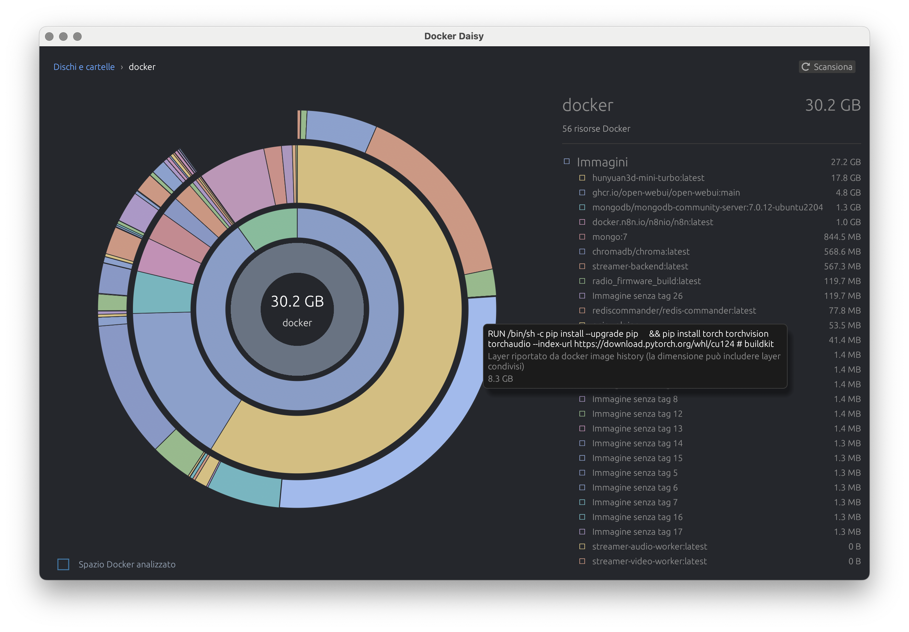

# Docker Daisy

App nativa per macOS, scritta in Rust con egui. Esplora lo spazio Docker con una mappa radiale ispirata a DaisyDisk.



## Funzioni

- Scansiona immagini, container e volumi usando il Docker CLI.
- Mostra nomi e tag leggibili al posto degli ID Docker.
- Usa anelli concentrici: totale Docker, gruppi di risorse e dettagli.
- Mostra sempre i layer delle immagini nell’anello esterno; i tooltip riportano il comando di creazione e la dimensione dichiarata da `docker image history`.
- Include nei container i volumi montati. Il totale Docker conta ogni volume una sola volta.
- Ordina risorse ed elenchi dalla più grande alla più piccola.
- Offre menu contestuali con conferma. Prima di eliminare ricontrolla lo stato e l’utilizzo tramite Docker e non cancella direttamente file dal filesystem.

## Avvio da sorgente

Requisiti: Rust stable e Docker Desktop avviato.

```sh
cargo run --release
```

## Creare l’app e il DMG

Su macOS, genera il bundle `.app` con l’icona e il DMG con il collegamento alla cartella Applicazioni:

```sh
./scripts/build-dmg.sh
```

Il comando crea `dist/Docker Daisy.app` e `dist/Docker Daisy-0.1.0-macos.dmg`. Senza certificato, l’app è firmata ad hoc per l’uso locale e il DMG non è firmato per la distribuzione. Per firmare entrambi con Developer ID, imposta l’identità:

```sh
DEVELOPER_ID_APPLICATION="Developer ID Application: Nome (TEAMID)" ./scripts/build-dmg.sh
```

Per notarizzare il DMG, configura un profilo `notarytool` nel Portachiavi e aggiungi `NOTARY_PROFILE="DockerDaisyNotary"` al comando.

## Build automatica e release GitHub

`.github/workflows/macos.yml` controlla la formattazione e carica il bundle `.app` e il DMG come artifact a ogni push, pull request e avvio manuale. Pubblica un DMG firmato su GitHub Releases quando viene inviato un tag `v*`.

Per firmare e notarizzare le release, configura i segreti GitHub `DEVELOPER_ID_APPLICATION`, `MACOS_CERTIFICATE_P12` (certificato in Base64), `MACOS_CERTIFICATE_PASSWORD`, `APPLE_ID`, `APPLE_APP_PASSWORD` e `APPLE_TEAM_ID`. Quando i segreti Apple sono presenti, il job firma e notarizza il DMG; senza, pubblica comunque un DMG non firmato, così il tag crea una release scaricabile anche prima di configurare il certificato.

Le dimensioni dei layer mostrate nell’anello provengono da `docker image history`: possono includere layer condivisi fra immagini e non vengono sommate di nuovo allo spazio totale, che usa invece lo spazio esclusivo riportato da Docker.
